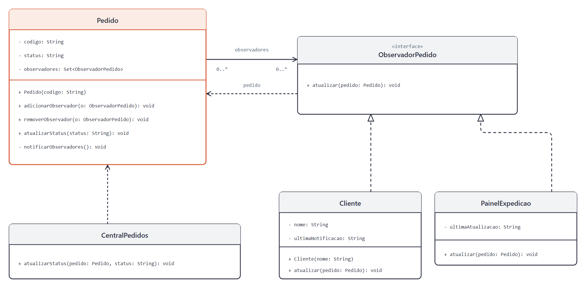

# DCC078 - Padrões de Projeto: Observer

**Aluno:** Felipe Lazzarini Cunha

## Tema

O projeto representa o acompanhamento de pedidos de uma loja. O Observer permite que clientes e painéis de expedição se inscrevam em um pedido e recebam notificações quando seu status muda. Observadores removidos deixam de receber atualizações, e repetir o status atual não gera uma nova notificação. As notificações são simuladas por mensagens de texto, sem envio real ou integração com sistemas externos.

## Diagrama de Classes UML



## Estrutura do Projeto

- `Pedido`: objeto observado que mantém o status e notifica os observadores inscritos.
- `ObservadorPedido`: interface comum aos observadores de um pedido.
- `Cliente` e `PainelExpedicao`: observadores concretos que registram a última mensagem recebida.
- `CentralPedidos`: cliente do padrão que registra mudanças de status nos pedidos.
- `PedidoTest`: testes das notificações, das inscrições e da independência entre pedidos.

## Testes

Com JDK 11 ou superior e Maven:

```bash
mvn test
```
